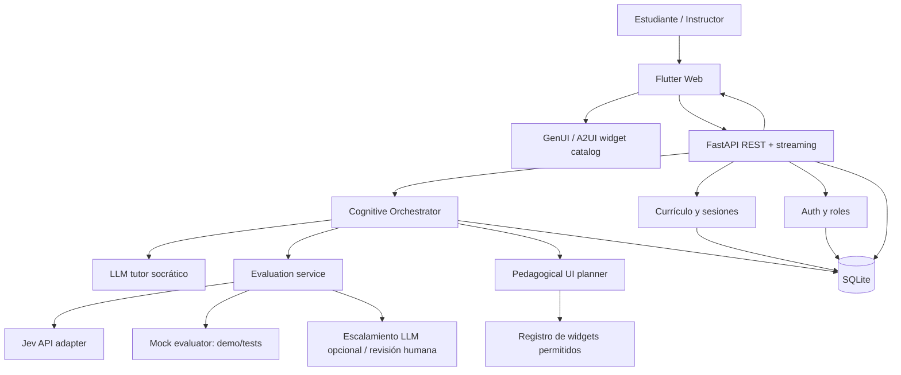

# CognitiveFlow AI — Plan maestro de implementación

> **Instrucciones para el agente de programación.** Implementar incrementalmente un prototipo funcional de CognitiveFlow AI para el **Track 2 — AI Systems to Stimulate Cognition** de CHARAL 2026. **Stack inicial obligatorio: Flutter Web + GenUI/A2UI + Python/FastAPI + SQLite**. La herramienta de evaluación será **Jev** (suscripción adquirida), desacoplada mediante un adaptador e intercambiable por evaluador simulado para desarrollo. **Google Gemini API** está disponible como proveedor previsto del tutor socrático; confirmar modalidad de autenticación de la clave antes de programar. La prioridad es un ciclo educativo completo y demostrable, no implementar todos los cursos antes de tener un MVP.

**Estado:** en curso — vertical slice ML sin IA + evaluación mock funcionando; integración Gemini + Jev pendiente (15 oct 2026).  
**Fecha de elaboración:** 15 de octubre de 2026.  
**Última actualización:** 15 de octubre de 2026.  
**Entrega objetivo CHARAL:** 31 de octubre de 2026 (verificar zona horaria/hora de cierre en convocatoria).  
**Destinatarios:** 4 estudiantes de formación técnica y 1 instructor.  
**Idioma UI:** español, preparado para i18n posterior.  
**Entorno de desarrollo:** Windows 11, PowerShell, Python con `uv`, Flutter Web. No exigir WSL ni Docker. **No utilizar nano: si se necesita editor de terminal, utilizar vim.**

---

## 0. Objetivo y alcance

Crear una plataforma que complemente cursos externos (Kaggle, Grafana, Ubuntu, Microsoft Learn, Astronomer, MIT, Hugging Face, LangChain, Evidently y DVC). Los estudiantes aprenden con esos recursos y usan CognitiveFlow para **demostrar comprensión mediante experiencias interactivas**. Un agente socrático elige la intervención siguiente a partir del objetivo curricular, la respuesta del estudiante, una rúbrica y la evaluación estructurada de Jev. Flutter GenUI presenta interfaces dinámicas dentro de un catálogo seguro de componentes educativos.

**Hipótesis a explorar:** un tutor socrático con laboratorios interactivos seleccionados según las dificultades del estudiante puede favorecer mejores justificaciones y mayor desempeño independiente que una interacción exclusivamente textual. No afirmar eficacia causal con una muestra piloto de cuatro personas.

**Resultados mínimos del MVP:**
1. El instructor puede iniciar sesión y visualizar sus cuatro estudiantes.
2. El alumno ve el currículo, ingresa a un tema y comienza un laboratorio.
3. El alumno manipula una actividad interactiva y entrega una respuesta con justificación.
4. El backend persiste intentos, eventos y cambios de hipótesis en SQLite.
5. Jev evalúa dimensiones puntuales; el sistema admite un evaluador simulado explícitamente etiquetado si falta acceso a Jev.
6. El agente socrático selecciona y produce una intervención GenUI usando componentes autorizados.
7. El estudiante responde de nuevo; termina en un postest individual **sin ayuda de IA**.
8. El instructor puede revisar intentos y puntuaciones, comparar con su propia rúbrica y exportar resultados anonimizados.
9. El sistema se encuentra desplegado en una URL HTTPS, con datos de demo y documentación de uso.

### Fuera del MVP (no bloquear el concurso)

- Integraciones OAuth con las plataformas de cursos y seguimiento automático de sus certificados.
- Ejecución arbitraria de Python, SQL o shell enviado por alumnos en servidores compartidos.
- Entrenar un LLM o el modelo Jev desde cero.
- Generar código Dart arbitrario desde un LLM en producción.
- Gráficas 3D avanzadas, videojuegos completos, aplicación móvil nativa, red social.
- Multitenancy empresarial, sistema de pagos, analítica a gran escala.
- Migración a PostgreSQL; dejar lista la capa ORM para hacerlo posteriormente.

---

## 1. Principios de producto y pedagogía

- **No dar la solución inmediatamente:** iniciar con predicciones, hipótesis, justificaciones y preguntas orientadoras; ofrecer explicación directa tras intentos razonables, solicitud expresa o señales de bloqueo.
- **Evaluar evidencia observable:** no confundir tiempo de uso, cantidad de clics o participación con aprendizaje.
- **Progreso genuino:** barras de avance por actividades completadas; nivel de dominio separado y basado en pruebas.
- **Evitar carga cognitiva innecesaria:** limitar opciones, generar una intervención principal por turno y conservar navegación estable.
- **Diseño transparente:** mostrar criterios de las evaluaciones; no añadir demoras artificiales para aparentar trabajo.
- **Feedback constructivo:** identificar puntos fuertes, errores específicos y siguiente acción, sin castigar errores exploratorios.
- **Inclusión:** teclado, lectores de pantalla, contraste, tamaños responsivos, textos alternativos, no depender del color.
- **Supervisión del instructor:** todas las puntuaciones de IA son orientativas y editables/comentables por el instructor.
- **Modo sin ayuda:** impedir pistas, LLM y solución durante el postest; almacenar ese contexto en el intento.

### Patrones UX concretos

| Principio | Implementación | Antipatrón a evitar |
|---|---|---|
| Gradiente de meta | `Desafío 2/4` con progreso real | Inflar progreso por actividad superficial |
| Pico-fin | Reflexión y resumen final de lo aprendido | Felicitar automáticamente un razonamiento incorrecto |
| Labor percibida | Estado real de evaluación y criterios consultados | Retrasos falsos |
| Von Restorff | Resaltar la evidencia a analizar y la acción principal | Colorear todos los elementos de forma llamativa |
| Sobrecarga de elección | Un widget de desafío y una pista contextual | Menús de herramientas interminables |

---

## 2. Arquitectura de referencia



### Responsabilidades

- **Flutter:** navegación estable, layout, formularios, simuladores deterministas, catálogo de widgets, accesibilidad, render y estado de UI. No almacenar claves privadas.
- **FastAPI:** validación de permisos, sesiones, historial, evaluación, lógica pedagógica y APIs. No ejecutar código del alumno sin sandbox aislado.
- **Cognitive Orchestrator:** máquina de estados del ciclo educativo, orquesta herramientas. Implementación simple en Python antes de considerar LangGraph.
- **Agente socrático:** Google Gemini mediante adaptador desacoplado; formula preguntas y selecciona la intervención pedagógica. No califica unilateralmente como autoridad final. Confirmar si la API disponible corresponde a Google AI Studio o Vertex AI antes de configurar la autenticación.
- **Jev:** clasifica o puntúa aspectos delimitados de respuestas; **no genera el texto de feedback**. Debe recibir contexto/rúbrica y retornar respuesta estructurada mediante el adaptador.
- **Pedagogical UI Planner:** selecciona `widget_type`, parámetros, objetivos y restricciones; GenUI presenta únicamente componentes registrados. Preferir selección determinista o JSON validado como primer paso.
- **SQLite:** persistencia local; usar SQLAlchemy 2.x, Alembic, claves foráneas, WAL, migraciones y backups. Evitar bases SQLite en sistemas de archivos efímeros de despliegue.

### Contrato de comunicación

Para las acciones de negocio, utilizar JSON validado con Pydantic. Para las superficies dinámicas, implementar un **adaptador A2UI compatible con la versión GenUI fijada**, no inventar un formato sustituto presentado como A2UI. Para el primer MVP, permitir `ui_spec` interna validada en backend y transformarla a mensajes A2UI oficiales.

**Fuentes técnicas a consultar antes de codificar:**
- Flutter GenUI: https://docs.flutter.dev/ai/genui
- Guía de inicio: https://docs.flutter.dev/ai/genui/get-started
- Paquete: https://pub.dev/packages/genui
- Repositorio: https://github.com/flutter/genui
- Documentación API Jev: https://jevmodel.org/docs/

> GenUI está en alpha y su API evoluciona. Registrar versión exacta resuelta en `pubspec.lock`. El repositorio anuncia cambios de arquitectura; no mezclar tutoriales de versiones incompatibles.

---

## 3. Stack y decisiones técnicas

| Capa | Tecnología | Comentarios |
|---|---|---|
| Frontend | Flutter Web, Dart | Material 3, diseño responsive, pantallas fijas + GenUI dinámico |
| Dynamic UI | `genui`, protocolo A2UI | Catálogo cerrado, adaptador server/client según versión |
| Gráficas | paquete Flutter de gráficos compatible | Seleccionar luego de prueba de compilación y mantenimiento |
| Estado | Riverpod o mecanismo equivalente | Elegir uno y mantener consistencia |
| Routing | `go_router` | Rutas con acceso por roles |
| API | FastAPI + Uvicorn | DTOs Pydantic y OpenAPI |
| Python | 3.12, administrado con `uv` | Versiones fijadas en lockfile |
| ORM | SQLAlchemy 2 + Alembic | Compatible con futura PostgreSQL |
| Datos | SQLite | Local/piloto; WAL, transacciones cortas y backups |
| Evaluación | Jev (SDK TypeSafe si la suscripción/API adquirida corresponde a TypeSafe; si no, API HTTP documentada del proveedor contratado) | Llave solo backend; validar proveedor y contrato real; timeouts y reintentos prudentes |
| Agente | Google Gemini API vía `google-genai` y adaptador propio | Confirmar AI Studio vs Vertex AI; no acoplar lógica pedagógica al SDK |
| Tests backend | `pytest`, `pytest-asyncio`, `httpx` | Fixtures de SQLite temporal |
| Tests Flutter | `flutter_test`, integration_test | Widget tests y flujos E2E |
| Calidad | `ruff`, mypy opcional, `flutter analyze` | CI sin Docker obligatorio |
| Despliegue | Frontend estático + backend persistente | HTTPS, CORS por origen, secretos de entorno |

**Configuración:** `.env.example` sin secretos; `.env` ignorado por Git; variables `DATABASE_URL`, `LLM_PROVIDER=gemini`, `GEMINI_API_KEY` (AI Studio, si aplica), `GOOGLE_CLOUD_PROJECT`/`GOOGLE_CLOUD_LOCATION` (Vertex AI, si aplica), `LLM_MODEL`, `JEV_API_KEY`, `JEV_BASE_URL` (solo si API HTTP), `EVALUATOR_MODE`, `CORS_ORIGINS`, `AUTH_SECRET`, `DEMO_MODE`. Nunca exponer estas claves en Flutter.

---

## 4. Organización de repositorio

```text
cognitiveflow/
├── README.md
├── AGENTS.md
├── docs/
│   ├── architecture.md
│   ├── pedagogy.md
│   ├── rubric.md
│   ├── threat-model.md
│   ├── ethics-and-data-governance.md
│   ├── deployment.md
│   ├── evaluation-protocol.md
│   └── diagrams/
├── frontend/
│   ├── pubspec.yaml
│   ├── lib/
│   │   ├── main.dart
│   │   ├── app/{routing,theme}/
│   │   ├── core/{api,auth,models,widgets}/
│   │   ├── features/{academy,labs,tutor,progress,instructor,capstone}/
│   │   └── genui/{catalog,renderers,transport}/
│   └── test/
├── backend/
│   ├── pyproject.toml
│   ├── uv.lock
│   ├── alembic/
│   ├── app/
│   │   ├── main.py
│   │   ├── core/{config,security,logging}.py
│   │   ├── db/{models,session}.py
│   │   ├── api/routes/
│   │   ├── schemas/
│   │   ├── services/{curriculum,attempts,evaluation,orchestrator,ui_planner}/
│   │   ├── agents/{socratic,prompts,provider}.py
│   │   ├── integrations/{jev,model_provider}.py
│   │   ├── labs/{data_detective,ml_experiment,model_monitoring}.py
│   │   └── seed/{curriculum,demodata}.py
│   └── tests/
├── research/
│   ├── rubrics/
│   ├── pilot_protocol.md
│   ├── anonymized_results/
│   └── analysis/
└── .github/workflows/
```

La estructura es orientativa. Priorizar cohesión funcional y pruebas; no crear archivos vacíos por cumplir un árbol ideal.

---

## 5. Modelo de datos SQLite

Utilizar UUID texto como ID público, timestamps ISO UTC, migraciones Alembic y `PRAGMA foreign_keys=ON`. Evitar almacenar transcripciones en columnas no controladas sin política de retención.

### Tablas principales

| Tabla | Campos recomendados |
|---|---|
| `users` | id, display_name, email_nullable, role(`student`/`instructor`), password_hash_nullable, created_at, active |
| `courses` | id, title, provider, url, description, order_index |
| `modules` | id, title, description, order_index, estimated_hours |
| `topics` | id, module_id, title, learning_objectives_json, prerequisites_json |
| `module_courses` | module_id, course_id |
| `student_course_progress` | student_id, course_id, status, self_reported_at, verified_by_instructor_at |
| `lab_templates` | id, topic_id, lab_type, title, config_json, difficulty, version |
| `rubrics` | id, topic_id, version, criteria_json, approved_by_instructor |
| `learning_sessions` | id, student_id, topic_id, status, started_at, finished_at |
| `lab_attempts` | id, session_id, lab_template_id, phase, answer_text, input_state_json, created_at |
| `evaluation_results` | id, attempt_id, evaluator, rubric_version, raw_result_json, normalized_scores_json, uncertainty_json, status |
| `interventions` | id, session_id, preceding_attempt_id, strategy, ui_spec_json, rationale_internal, created_at |
| `interaction_events` | id, session_id, event_type, event_payload_json, occurred_at |
| `mastery_evidence` | id, student_id, topic_id, source_attempt_id, reviewed_by, evidence_type, result_json |
| `instructor_reviews` | id, attempt_id, instructor_id, rubric_scores_json, notes, reviewed_at |
| `capstone_projects` | id, title, description, status, repository_url_nullable |
| `capstone_members` | project_id, student_id, responsibility |
| `audit_events` | id, actor_id, action, object_type, object_id, timestamp |

### Reglas

- No guardar scores de Jev como si fueran automáticamente una medida objetiva de aprendizaje. Registrar nombre del evaluador, versión del prompt/rúbrica y `status`.
- Guardar la secuencia temporal de respuestas y actividad, para reproducir las intervenciones.
- Minimizar PII; pseudonimizar exportaciones.
- Preparar índice en `student_id`, `topic_id`, `session_id` y fechas; vigilar acceso concurrente.
- WAL solo en disco persistente local y un proceso/esquema de despliegue compatible. Para escalar se migrará PostgreSQL.

---

## 6. Currículo completo

### Módulo 1. Herramientas de desarrollo
- Ubuntu Command Line for Beginners: https://ubuntu.com/tutorials/command-line-for-beginners#1-overview
- Microsoft Learn — Intro to Git: https://learn.microsoft.com/es-es/training/modules/intro-to-git/
- Competencias: filesystem, pipes, comandos seguros, commits, ramas, merge, conflictos y lectura de diffs.
- Laboratorio: terminal **simulada** y grafo Git interactivo.

### Módulo 2. Datos y consultas
- Kaggle Learn Pandas: https://www.kaggle.com/learn/pandas
- Kaggle Learn Data Visualization: https://www.kaggle.com/learn/data-visualization
- Kaggle Learn Data Cleaning: https://www.kaggle.com/learn/data-cleaning
- Kaggle Learn Intro to SQL: https://www.kaggle.com/learn/intro-to-sql
- Kaggle Learn Advanced SQL: https://www.kaggle.com/learn/advanced-sql
- Competencias: limpieza, faltantes, duplicados, joins, agregaciones, ventanas, sesgos y visualización.
- Laboratorio MVP: **Data Detective**.

### Módulo 3. Machine Learning y explicabilidad
- Kaggle Learn Intro to Machine Learning: https://www.kaggle.com/learn/intro-to-machine-learning
- Kaggle Learn Intermediate Machine Learning: https://www.kaggle.com/learn/intermediate-machine-learning
- Kaggle Learn Feature Engineering: https://www.kaggle.com/learn/feature-engineering
- Kaggle Learn Machine Learning Explainability: https://www.kaggle.com/learn/machine-learning-explainability
- Competencias: entrenamiento/validación, leakage, overfitting, underfitting, métricas, importancias/SHAP, hipótesis.
- Laboratorio MVP: **ML Experiment Lab**.

### Módulo 4. Deep Learning
- Kaggle Intro to Deep Learning: https://www.kaggle.com/learn/intro-to-deep-learning
- Deep Learning video (curso proporcionado por instructor): https://www.youtube.com/watch?v=II4giR4vOOo&list=PLtBw6njQRU-rwp5__7C0oIVt26ZgjG9NI
- Recurrent Neural Networks video: https://www.youtube.com/watch?v=d02VkQ9MP44&list=PLtBw6njQRU-rwp5__7C0oIVt26ZgjG9NI
- Convolutional Neural Networks video: https://www.youtube.com/watch?v=pqIcoskUuWs&list=PLtBw6njQRU-rwp5__7C0oIVt26ZgjG9NI
- Competencias: funciones de pérdida, backpropagation, activaciones, regularización, CNN/RNN.
- Laboratorio futuro: visualizador de red neuronal y de convoluciones.

### Módulo 5. Modalidades especializadas
- Kaggle Time Series: https://www.kaggle.com/learn/time-series
- Kaggle Computer Vision: https://www.kaggle.com/learn/computer-vision
- Competencias: validación temporal, tendencias/estacionalidad, imágenes, filtros, métricas visuales.
- Laboratorio futuro: series temporales interactivas + convolución visual.

### Módulo 6. MLOps, datos y observabilidad
- Grafana Fundamentals: https://learn.grafana.com/path/grafana-fundamentals
- Apache Airflow 101: https://academy.astronomer.io/path/airflow-101
- Evidently AI: https://learn.evidentlyai.com/
- DVC Data Scientist Path: https://learn.dvc.org/course/data-scientist-path
- Competencias: DAG, seguimiento reproducible, data drift, métricas operacionales, monitoreo.
- Laboratorio MVP: **Model Monitoring Lab**.

### Módulo 7. Agentes y contexto
- Hugging Face Context Course: https://huggingface.co/context-course
- LangGraph video: https://youtu.be/jGg_1h0qzaM
- LangGraph certification course: https://academy.langchain.com/courses/intro-to-langgraph
- Competencias: estados, grafos, herramientas, contexto, recuperación de errores y límites de autonomía.
- Laboratorio futuro: grafo interactivo de agente.

### Módulo 8. Proyecto integrador
- Tema sugerido: **Industrial AI Monitoring Platform** (puede utilizar datos abiertos/sintéticos cuando los industriales no se puedan divulgar).
- Cobertura: ingesta SQL/Pandas, limpieza, modelos, evaluación, Git/DVC, Airflow, observabilidad Grafana/Evidently y opcional agente LangGraph.
- Roles distribuidos: ingeniería de datos; modelado; MLOps/observabilidad; agentes/integración. Cada estudiante debe defender el sistema completo.
- Evidencia: repositorio, pipeline, modelo justificado, tablero, alertas, documentación, exposición, revisión de limitaciones.

**Nota:** Los recursos externos son materiales de referencia; no reutilizar su contenido íntegro sin permiso. Mantener enlaces y redactar desafíos originales.

---

## 7. Catálogo de componentes GenUI

**Regla:** el LLM **selecciona, parametriza y compone** widgets aprobados; no ejecuta código remoto ni construye widgets arbitrarios. Validar props con esquema y límites.

| Componente | Propósito | Eventos mínimos |
|---|---|---|
| `SocraticQuestionCard` | Pregunta, objetivo y contexto | `answerSubmitted`, `hintRequested` |
| `HypothesisEditor` | Hipótesis textual y justificación | `hypothesisSubmitted`, `hypothesisRevised` |
| `ChoiceReasoningWidget` | Elección + explicación obligatoria | `selectionChanged`, `reasoningSubmitted` |
| `DataTableExplorer` | Ordenar, filtrar y reconocer anomalías | `rowsSelected`, `filterApplied` |
| `SqlQueryWorkbench` | Consultas sobre dataset **de solo lectura y controlado** | `querySubmitted` |
| `LearningCurveSimulator` | Hiperparámetros y curvas de pérdida | `parameterChanged`, `predictionSubmitted` |
| `DriftDistributionExplorer` | Histograma de referencia vs actual | `featureSelected`, `analysisSubmitted` |
| `EvidenceComparison` | Comparar afirmaciones o gráficos | `evidenceSelected`, `argumentSubmitted` |
| `ConceptMapBuilder` | Relacionar conceptos | `edgeAdded`, `mapSubmitted` |
| `PipelineDAGBuilder` | Crear dependencias y diagnosticar fallos | `nodeConnected`, `diagnosisSubmitted` |
| `RubricFeedbackCard` | Retroalimentación y criterios | `reviewRequested` |
| `ReflectionSummary` | Reflexión pico-fin sin inflar logros | `reflectionSubmitted` |

### Límites operativos

- Renderizar tarjetas/textos del LLM escapados y saneados; no ejecutar Markdown/HTML no confiable.
- Evitar superficies demasiado grandes; una actividad central y pistas contextuales.
- Accesibilidad: usar controles de Flutter con etiquetas y navegación de teclado.
- No permitir que LLM establezca una URL arbitraria o comando ejecutable; usar whitelist.
- El backend no confía en puntuaciones, soluciones o permisos reportados por frontend.
- Al cambiar de fase `posttest`, desactivar `hintRequested` y feedback evaluativo hasta entrega.

### Ejemplo de intención UI interna (NO es payload A2UI oficial)

```json
{
  "type": "LearningCurveSimulator",
  "version": 1,
  "learning_objective": "Distinguir entrenamiento de generalización",
  "title": "Explora el sobreajuste",
  "parameters": {
    "complexity": {"min": 1, "max": 10, "initial": 5},
    "noise_pct": {"min": 0, "max": 50, "initial": 20}
  },
  "reasoning_prompt": "Predice el efecto de aumentar la complejidad y justifica por qué",
  "requires_justification": true
}
```

El servidor transforma esta intención validada a mensajes A2UI conforme al SDK fijado. Incluir pruebas de contrato con Flutter.

---

## 8. Laboratorios prioritarios

### 8.1 Data Detective — Pandas / Cleaning

**Escenario:** dataset de producción ficticio con faltantes, duplicados, unidades mezcladas, outliers y fuga de información deliberada.

Secuencia:
1. Mostrar tabla de 20–100 filas sintéticas.
2. Pedir al estudiante **predecir** qué errores pueden perjudicar un modelo.
3. Permitir filtros, selección de columnas y marcado de anomalías.
4. Solicitar justificación textual y plan de limpieza.
5. Evaluar criterios con Jev; verificar checks deterministas cuando sea posible.
6. Agente hace pregunta socrática basada en la deficiencia dominante.
7. Mostrar nueva tabla/contraste; exigir revisión de hipótesis.
8. Postest sobre tabla nueva sin pistas.

Métricas: detección de problemas, justificación, distinción entre outlier y error, consideración de leakage.

### 8.2 ML Experiment Lab — overfitting / validación

**Escenario:** curvas de entrenamiento y validación con parámetros de complejidad, ruido y tamaño de muestra. Para el primer sprint utilizar función determinista **etiquetada como simulación**; entrenamiento de modelos real opcional después.

Secuencia:
1. Estudiante predice comportamiento de dos curvas.
2. Manipula complejidad/ruido en sliders; experimenta.
3. Justifica diagnóstico y propone mitigación.
4. Evaluación de exactitud conceptual + evidencia + razonamiento.
5. Agente elige `EvidenceComparison` o pregunta sobre alternativa.
6. Repetición y reflexión; postest independiente.

Métricas: razonamiento causal, uso de ambas curvas, generalización, evidencia experimental.

### 8.3 Model Monitoring Lab — drift / Evidently / Grafana

**Escenario:** distribución de referencia vs actual de brillo, temperatura o presión en una línea industrial simulada; observaciones temporales y predicciones.

Secuencia:
1. Mostrar histogramas comparativos y una serie temporal.
2. Solicitar hipótesis de drift y qué métrica usar.
3. Permitir explorar períodos/características.
4. Pedir distinguir **data drift, concept drift y degradación del rendimiento**.
5. Evaluación: evidencia, incertidumbre, decisión proporcionada.
6. Generar siguiente desafío: analizar si reentrenar está justificado o solo monitorear.
7. Postest con una nueva distribución.

Métricas: distinción entre cambio de distribución y desempeño, no reentrenar automáticamente, decisiones basadas en evidencia.

---

## 9. Orquestación del tutor socrático

### Máquina de estados

```text
NOT_STARTED
    -> DIAGNOSTIC
    -> CHALLENGE_PRESENTED
    -> PREDICTION_SUBMITTED
    -> EXPLORATION
    -> JUSTIFICATION_SUBMITTED
    -> EVALUATING
    -> INTERVENTION_SELECTED
    -> REVISION (0..N ciclos acotados)
    -> POSTTEST_LOCKED
    -> POSTTEST_SUBMITTED
    -> REFLECTION
    -> COMPLETED
```

- Un intento puede fallar, expirar o ser interrumpido: debe reanudarse.
- Limitar intervenciones encadenadas por actividad (configurable) para evitar bucles.
- El agente debe poder dar ayuda razonable si el estudiante se atasca, sin fingir que nunca puede dar respuestas.
- El instructor puede anular puntuaciones, asignar actividad y cerrar sesión.
- Postest: nueva variante equivalente, sin acceso al tutor durante evaluación.

### Contrato conceptual del agente

**Entradas:** tema/objetivo, actividad, rúbrica versionada, historial de interacción mínimo, intento actual, evaluación Jev y nivel de ayuda permitido.

**Salidas validadas:**

```json
{
  "strategy": "request_evidence",
  "reason": "La respuesta no utiliza datos de validación",
  "widget_type": "EvidenceComparison",
  "widget_parameters": {"comparison_id": "learning_curves_v1"},
  "socratic_question": "¿Qué observación de ambas curvas respalda tu hipótesis?",
  "difficulty_delta": 0,
  "give_direct_answer": false
}
```

`reason` es razonamiento pedagógico breve para auditoría, **no chain-of-thought interno** del modelo. Nunca pedir ni almacenar razonamiento interno oculto.

### Reglas del selector de intervención

| Señal | Acción |
|---|---|
| Respuesta correcta sin fundamento | Pedir evidencia o comparación |
| Error de concepto básico | Presentar ejemplo contrastivo y pregunta sencilla |
| Afirmación no soportada | Pedir fuente, dato o experimento |
| Razonamiento suficiente | Aumentar dificultad o proponer transferencia |
| Inconsistencia entre respuestas | Preguntar por la contradicción |
| Evaluación ambigua | Evaluador alternativo o revisión humana, sin presentar score definitivo |
| Respuesta vacía | Solicitar hipótesis inicial y ofrecer pista opcional |

---

## 10. Jev: integración, rúbricas y límites

La documentación oficial de Jev describe `POST /v1/systemone` y preguntas tipadas con respuestas estructuradas; no es un LLM generativo para explicar resultados. **Antes de implementar, consultar el esquema actual de autenticación, request y response directamente desde su documentación; no asumir nombres de campos a partir de este documento.**

### Servicio de evaluación

Interfaz Python sugerida:

```python
from typing import Protocol

class CognitiveEvaluator(Protocol):
    async def evaluate(self, context: dict, rubric: dict) -> dict: ...

class JevEvaluator:
    async def evaluate(self, context: dict, rubric: dict) -> dict:
        # Convertir criterios a preguntas tipadas admitidas por Jev.
        # Invocar API con timeouts y rate-limit handling.
        # Convertir respuesta a EvaluationResult validado.
        ...

class MockEvaluator:
    async def evaluate(self, context: dict, rubric: dict) -> dict:
        # Determinista para pruebas y demo; resultados siempre etiquetados.
        ...
```

### Dimensiones de rúbrica (0–4, anclajes definidos)

| Criterio | 0 | 2 | 4 |
|---|---|---|---|
| Exactitud conceptual | Incorrecto | Parcialmente correcto | Correcto y preciso |
| Uso de evidencia | Sin evidencia | Menciona datos sin relacionarlos | Evidencia pertinente que sustenta conclusión |
| Razonamiento causal | No explica relaciones | Explicación parcial | Relaciones y límites claramente explicados |
| Consideración de alternativas | Ninguna | Alternativa superficial | Alternativas plausibles y criterios para distinguirlas |
| Metacognición / revisión | No revisa | Corrige parcialmente | Identifica y justifica la revisión |

**Importante:** si Jev no soporta la escala completa de un criterio, convertir el criterio en varias comprobaciones binarias o categorizar con un LLM evaluador independiente; no fingir que una probabilidad equivale directamente a una nota de 0–4.

### Normalización de salida interna

```json
{
  "evaluator": "jev",
  "status": "evaluated",
  "rubric_version": "ml-overfitting-v1",
  "criteria": [
    {"id": "uses_validation_curve", "label": "Uso de curva de validación", "decision": "yes", "confidence_raw": null},
    {"id": "mentions_generalization", "label": "Generalización", "decision": "yes", "confidence_raw": null}
  ],
  "requires_review": false,
  "feedback_generated_by": null
}
```

La confianza solo se almacena cuando exista en la respuesta real de Jev y no debe presentarse como porcentaje de dominio del alumno. Las evaluaciones multi-criterio y sus interpretaciones deben calibrarse con el instructor.

### Fallbacks y confiabilidad

- `EVALUATOR_MODE=mock|jev` y bandera `demo_mode` visible para instructor.
- Si Jev falla por red o autorización, mostrar estado **pendiente de evaluación**, no aprobar automáticamente.
- Puede existir revisión secundaria por LLM para casos ambiguos, con distinta etiqueta de evaluador.
- Registrar solicitudes/respuestas con **redacción de PII** en logs; limitar contenido de logs.
- Pruebas contra golden set etiquetado por instructor: exactitud por criterio, acuerdo, sesgos, estabilidad y latencia.

---

## 11. Pantallas y rutas

| Ruta | Rol | Contenido |
|---|---|---|
| `/login` | Todos | Login demo y acceso seguro al piloto |
| `/academy` | Estudiante | 8 módulos y cursos externos enlazados |
| `/academy/:moduleId` | Estudiante | Temas, objetivos y prerequisitos |
| `/labs` | Estudiante | Catálogo de laboratorios disponibles |
| `/labs/:labId` | Estudiante | Actividad GenUI, conversación y estado |
| `/tutor` | Estudiante | Historial socrático contextualizado |
| `/progress` | Estudiante | Evidencias, progreso y evolución por criterio |
| `/capstone` | Estudiante | Hitos y defensas del proyecto final |
| `/instructor` | Instructor | Vista 4 estudiantes, progreso y alertas de revisión |
| `/instructor/students/:id` | Instructor | Historial, calificaciones IA y revisión humana |
| `/instructor/rubrics` | Instructor | Visualización y edición versionada de rúbricas |

### Estilo UI

- Inspirado en el mockup de CognitiveFlow: fondo claro, azul/violeta para acción primaria, tarjetas con jerarquía, lateral estable, progreso real arriba.
- Layout desktop: sidebar + panel principal + evaluación contextual. En móvil, evaluación en tabs/panel expandible.
- Conservar fondo y navegación Flutter estáticos; **GenUI vive en el área educativa**, no controla todo el shell.
- El estudiante no debe ver métricas automáticas mientras está haciendo un postest sin ayuda.
- No usar identidades o imágenes reales de alumnos en demos públicas.

---

## 12. Endpoints FastAPI

Crear OpenAPI y pruebas por endpoint. Mantener nombres REST consistentes.

```text
GET    /health
POST   /auth/login
GET    /auth/me
GET    /modules
GET    /modules/{module_id}/topics
GET    /courses
GET    /labs
GET    /labs/{lab_id}
POST   /sessions
GET    /sessions/{session_id}
POST   /sessions/{session_id}/events
POST   /sessions/{session_id}/attempts
POST   /sessions/{session_id}/evaluate
POST   /sessions/{session_id}/next-intervention
POST   /sessions/{session_id}/posttest
POST   /sessions/{session_id}/reflection
GET    /students/me/progress
GET    /instructor/students
GET    /instructor/students/{student_id}/sessions
POST   /instructor/attempts/{attempt_id}/reviews
GET    /instructor/export?format=csv
```

**Streaming GenUI:** agregar un endpoint separado (`/sessions/{id}/ui/stream`) solo cuando exista el adaptador correcto; usar SSE o WebSocket según la versión elegida. No abrir SSE/WebSocket si el producto aún no consume eventos reales.

### Reglas de API

- `POST /attempts`: idempotencia mediante `client_event_id` UUID; evitar duplicados por doble clic.
- Todos los endpoints validan identidad/rol y propiedad de sesión.
- `POST /evaluate`: backend obtiene el intento y rúbrica desde DB; no confiar en rúbrica libre enviada por cliente.
- Exportación de instructor sin PII innecesaria.
- Paginar sesiones/intentos en panel.
- Códigos HTTP claros y errores seguros (no retornar claves ni prompts del sistema).

---

## 13. Seguridad, privacidad y gobernanza

- Consentimiento de estudiantes para piloto, uso de sus respuestas y análisis; opción de retirar datos.
- Guardar lo mínimo: usar pseudónimos para evaluación/exports.
- Contraseñas con hash robusto si se usa login local; nunca plaintext.
- Límite de intentos, autenticación, control por roles y CORS específico.
- Separar `demo` de datos reales; datos demo enteramente sintéticos.
- No usar datos industriales confidenciales ni subir imágenes de planta a proveedores externos sin autorización.
- Prompts de cursos/archivos se consideran **contenido no confiable**, no instrucciones del sistema.
- Evitar fuga de soluciones del postest al estudiante antes de terminar.
- Guardrails de contenidos, validación de JSON de UI, rate limiting, máximo de tokens y timeout.
- Mostrar versión de rúbrica/modelo; instructor revisa decisiones sensibles.
- Definir política de retención y mecanismo de eliminación de datos por usuario.
- Documentar errores del evaluador, incertidumbre y posibles sesgos por estilo de escritura, nivel del alumno o longitud de respuestas.
- No utilizar evaluaciones automatizadas para notas académicas definitivas sin revisión del instructor.

---

## 14. Evaluación educativa del prototipo

### Piloto con 4 estudiantes

Estudio exploratorio de casos, no ensayo concluyente. Recoger consentimiento; no condicionar calificaciones académicas a participar.

1. **Pretest** sin tutor con 2–3 problemas breves del mismo objetivo.
2. **Intervención** en los 3 laboratorios con tutor + GenUI; registrar secuencias.
3. **Postest independiente** con ítems equivalentes, sin pistas ni tutor.
4. **Evaluación humana** de respuestas con rúbrica predefinida; en lo posible sin ver si es pre/post.
5. **Revisión Jev vs instructor:** comparar decisiones binarias por criterio, discrepancias, tiempo y costo.
6. **Entrevista de usabilidad breve:** dificultades, utilidad de widgets, momentos de confusión, percepción de autonomía.
7. Reportar descriptivamente cambios por alumno y actividad, casos de mejora/no mejora y limitaciones.

### Métricas

- Ganancia pre/post por criterio: **descriptiva**, sin extrapolación poblacional.
- Porcentaje de justificaciones con evidencia pertinente.
- Tasa de revisiones de hipótesis justificadas.
- Tiempo por actividad y abandonos (UX; no inferir cognición directamente).
- Concordancia Jev–instructor sobre criterios observables; matriz de confusión si aplica.
- Latencia P50/P95 y costo por evaluación.
- Fallos de UI generativa, actividades no renderizadas y recuperaciones.

### Para futuras investigaciones

Comparar con tutor socrático solo textual y/o chatbot genérico, asignación aleatoria y mayor muestra. Evitar afirmar que GenUI o Jev son superiores sin comparativa controlada.

---

## 15. Plan de ejecución hasta CHARAL

**La fecha objetivo es 31 de octubre de 2026: ~16 días a partir del 15 de octubre.** Evitar intentar implementar toda la academia antes de exhibir un flujo funcional.

| Período | Entrega | Criterio de aceptación |
|---|---|---|
| 15–16 oct | Base repo, Flutter, FastAPI, SQLite, migración, seed 4 alumnos | Frontend y API arrancan localmente; `/health` y `/modules` responden |
| 17–18 oct | Layout, login demo, academia, temas, navegación | Navegación, roles, 8 módulos cargados desde SQLite |
| 19–21 oct | Laboratorio ML con widgets deterministas y respuestas | Flujo pregunta→simulación→justificación se persiste |
| 22–23 oct | Evaluador Jev y mock; rúbricas; audit trail | Se evalúa respuesta sin filtrar secretos; mock estable; fallo Jev seguro |
| 24–25 oct | Tutor socrático + UI planner + GenUI/A2UI | El resultado del evaluador selecciona y muestra un widget apropiado |
| 26–27 oct | Data Detective y Model Monitoring reducidos; postest | 3 laboratorios mínimos; al menos uno con ciclo completo end-to-end |
| 28 oct | Piloto con 4 alumnos y correcciones | Datos anotados, incidentes y limitaciones documentados |
| 29 oct | Deploy público, pruebas de recuperación y revisión permisos | URL HTTPS, sesiones, DB persistente, navegación sin errores críticos |
| 30 oct | Video de 5 min, deck, gobernanza 3–5 páginas, README | Entregables reproducibles y demo guionizada |
| 31 oct | Submisión y verificación del portal | Enlace, GitHub y documentos enviados y comprobados |

### Regla de priorización

Si el tiempo aprieta, mantener **un único ML Experiment Lab perfectamente funcional**, evaluación Jev real o fallback claramente declarado, pregunta socrática adaptativa, postest, instructor y documentación. Recortar amplitud antes que sacrificar integridad científica o confiabilidad.

---

## 16. Backlog por épicas y tickets ejecutables

### Épica A — Infraestructura

- [x] A1 Monorepo + README + `.gitignore` + `frontend/` + `backend/` + push inicial a `github.com/MJVNOR/CognitiveFlow-AI` (falta `AGENTS.md`).
- [x] A2 Configurar Python 3.12 con `uv` y pytest (falta `ruff`).
- [x] A3 Configurar Flutter Web 3.47.7, `flutter analyze` + `flutter test` en verde (rutas con `NavigationBar`; falta `go_router`).
- [ ] A4 Definir `.env.example`, error handler y logs sin secretos.
- [ ] A5 Integrar GitHub Actions para Flutter analyze/test y pytest.

### Épica B — Datos

- [x] B1 SQLAlchemy y conexión SQLite; WAL + `PRAGMA foreign_keys=ON`.
- [x] B2 Datos semilla reproducibles vía `app/seed.py` (Alembic diferido hasta congelar schema pre-piloto).
- [x] B3 Cuatro estudiantes demo y un instructor (`s1-s4`, `i1`).
- [x] B4 Seed de 8 módulos y tres laboratorios (falta tabla `courses` con URLs externas).
- [x] B5 CRUD de sesiones/intentos + propiedad por rol (403 ajeno, instructor total; `GET /sessions/{id}` para reanudar).

### Épica C — Frontend

- [x] C1 Shell responsive con 4 tabs basado en mockup (theme mínimo).
- [x] C2 Login demo (`/auth/login` s1-s4/i1), academia desde `/modules` real y listado de laboratorios.
- [x] C3 Detalle de laboratorio y estados cargando/error/sin red.
- [x] C4 Panel de instructor mínimo (4 estudiantes vía `/instructor/students`; falta historial).
- [x] C5 Test de shell (`flutter test` 1 passed); falta accesibilidad y móvil.

### Épica D — Laboratorio ML (vertical slice)

- [x] D1 Generador determinista de curvas (`app/labs_ml.py`, etiquetadas sintéticas).
- [x] D2 Flutter gráfico con sliders, selecciones y justificación (`LabDetailPage`).
- [x] D3 Tracking de intentos e hipótesis previas (`GET /sessions/{id}/attempts`).
- [x] D4 Postest con variante nueva sin pistas (`seed=99`, `POST /posttest` bloquea tutor/intervenciones con 403, doble postest rechazado; verificado live).
- [x] D5 Resumen final honesto y registro (`POST /reflection` cierra sin inflar logros; texto persistido).

### Épica E — Evaluación

- [x] E1 Rúbrica inicial de overfitting (`ml-overfitting-v1`, 5 criterios).
- [x] E2 Contrato `MockEvaluator` determinista + `POST /sessions/{id}/evaluate` (etiquetado `mock`).
- [x] E3 Integración Jev real (`jev-api.org/v1/systemone`, `noul` x5, UA obligatorio, `EVALUATOR_MODE=mock|jev`; verificado live 15 oct, 1 crédito).
- [x] E4 Traducción de decisiones Jev a salida interna tipada (mapping noul→score heurístico y documentado; fallo → `pending` sin scores).
- [x] E5 Revisión humana append-only (`POST /instructor/attempts/{id}/reviews`, 0-4 validado, jamás toca `evaluation_results`) + export CSV anonimizado + vista Flutter (verificado live).

### Épica F — Tutor y GenUI

- [x] F1 Adapter Gemini vía Interactions API (`POST /v1beta/interactions`, `gemini-3.8-flash`, reintento ante 503, timeout 25s) con fallback mock etiquetado; `POST /sessions/{id}/socratic`.
- [x] F2 Reglas socráticas deterministas (`POST /sessions/{id}/next-intervention`: débil→evidencia, sólida→transferencia, ambigua→aclarar; 16 tests).
- [x] F3 UI planner con catálogo cerrado (12 widgets) + `validate_ui_spec` y fallback seguro.
- [x] F4 Catálogo Flutter GenUI (`genui 0.10.4` fijado en `pubspec.lock`, `lib/genui/catalog.dart` con 3 items + tests de contrato; eventos nativos A2UI pendientes).
- [x] F5 Flujo evento→backend→evaluación→intervención→GenUI→evento (`TutorSurface`: ui_spec→A2UI v0.9→`SurfaceController`→`Surface`, verificado con test).
- [ ] F6 Fallback cuando falla LLM/Jev o el UI spec no valida.

### Épica G — Dos laboratorios adicionales

- [x] G1 Data Detective reducido (dataset sintético 30 filas/7 plantados deterministas, `GET /labs/{id}/dataset` sin filtrar, rúbrica `data-cleaning-v1` con checks exactos, rama datos en evaluate/intervenciones, `DataLabPage` + postest seed 99 + item GenUI; verificado live).
- [x] G2 Monitoring reducido (serie 180 pts + histogramas ref/actual con deriva plantada determinista, rúbrica `drift-v1` con changepoint exacto, rama monitoreo, `MonitorLabPage` + postest seed 99 + item GenUI; verificado live).
- [x] G3 Rúbricas de ambos y postests pequeños (`data-cleaning-v1` + `drift-v1`, postest seed 99 en Data y Monitor; Jev real solo en ML por ahora).

### Épica H — Investigación y entregables

- [ ] H1 Protocolo piloto con consentimiento y anonimización.
- [ ] H2 Capturar resultados de cuatro estudiantes; revisión humana.
- [ ] H3 Documento ético y gobernanza (3–5 páginas).
- [ ] H4 Arquitectura, despliegue, prompts y revisión de fallos.
- [ ] H5 Video de 5 minutos y presentación.
- [ ] H6 Deploy, smoke tests y envío a CHARAL.

---

## 16.1. Estado confirmado y próximo sprint (actualización del 15/oct/2026)

**Este estado proviene de las casillas del documento entregado, no de una auditoría del código fuente.** Preservar las casillas `[x]` existentes y no marcar nuevas tareas hasta verificar implementación y pruebas dentro del repositorio.

- **18 tickets marcados `[x]`**: A1–A3 (3), B1–B5 (5), C1–C5 (5), D1–D3 (3), E1–E2 (2).
- **22 tickets pendientes `[ ]` en el backlog original**: A4–A5 (2), D4–D5 (2), E3–E5 (3), F1–F6 (6), G1–G3 (3), H1–H6 (6). Se añaden 4 tareas nuevas I1–I4, también pendientes.
- **Vertical slice ya declarado funcional:** Flutter + SQLite + FastAPI, 8 módulos sembrados, cuatro estudiantes demo, laboratorio ML de curvas sintéticas, intentos persistidos, rúbrica `ml-overfitting-v1` y `MockEvaluator`.
- **Deuda técnica reconocida en tickets marcados:** `AGENTS.md`, `.gitignore`, `ruff`, `go_router`, Alembic, tabla `courses` y URLs, controles de roles, historial de instructor, accesibilidad y vista móvil.

### Siguiente orden de implementación — no reiniciar el proyecto

1. **Auditoría (obligatoria):** `git status`, estructura real, `uv run pytest`, `flutter analyze`, `flutter test`, endpoints ya existentes. No borrar ni regenerar componentes funcionales.
2. **Seguridad/configuración:** A4, `.env.example`, secretos fuera del repositorio, tratamiento de errores y comprobación de proveedor real de Jev; distinguir Jev TypeSafe de cualquier servicio tercero denominado "Jev".
3. **Jev real:** E3 y E4. Validar API y contrato con credencial en backend; mapear decisiones a esquema tipado; registrar `evaluator=jev` solo si hubo respuesta real. Probar fallas con mocks sin consumir saldo en CI.
4. **Gemini:** F1. Agregar un proveedor `GeminiSocraticProvider` con `google-genai`; conservar opción de mock determinista. Configurar modelo por variable de entorno; límites de tokens, reintentos, timeouts y JSON/schema validado.
5. **Orquestación:** F2–F3. Tras Jev, política pedagógica explícita que selecciona intervención (evidencia, contraejemplo, pregunta, transferencia). Limitar bucles.
6. **GenUI real:** F4–F6. Fijar versiones de `genui`/A2UI, catálogo cerrado y evento de retorno validado; no confundir un formulario Flutter estático con generación dinámica.
7. **Completar laboratorio ML:** D4–D5. Postest sin pistas y resumen que diferencie progreso del curso de dominio cognitivo.
8. **Protección y piloto:** autorización de estudiantes, historial instructor E5, golden set con revisión humana, CI y despliegue persistente.
9. **Solo si sobra tiempo:** G1/G2 en versión compacta; sin sacrificar el flujo ML integral ni entregables de CHARAL.

### Nuevos tickets — configuración de proveedores y seguridad

- [ ] I1 Verificar proveedor/plataforma de suscripción Jev y documentar el endpoint/SDK efectivamente utilizable (sin exponer credenciales).
- [ ] I2 Verificar si la clave Google es Gemini AI Studio o Vertex AI y realizar llamada smoke test desde FastAPI.
- [ ] I3 Pruebas de configuración: con claves ausentes usar `mock` etiquetado; nunca hacer fallback silencioso de real a mock.
- [ ] I4 Añadir límites de consumo por estudiante/sesión y protección contra prompts de estudiantes que pidan revelar soluciones o secretos.

### Variables de entorno orientativas

```dotenv
DATABASE_URL=sqlite+aiosqlite:///./cognitiveflow.db
LLM_PROVIDER=gemini
LLM_MODEL=<modelo_habilitado_en_la_cuenta>
GEMINI_API_KEY=
JEV_API_KEY=
EVALUATOR_MODE=mock
DEMO_MODE=true
CORS_ORIGINS=http://localhost:3000
```

Para Vertex AI utilizar configuración de Google Cloud adecuada en lugar de asumir `GEMINI_API_KEY`. No incluir valores reales en `.env.example`. El uso de `aiosqlite` requiere que el backend lo tenga instalado; si el proyecto existente usa SQLite síncrono, conservarlo hasta decidir una migración explícita.

---

## 17. Criterios de aceptación del MVP (Definition of Done)

- [ ] En entorno limpio, las instrucciones del README permiten ejecutar la aplicación sin pasos ocultos.
- [ ] SQLite se crea mediante migración y se puebla de cuatro estudiantes demo, ocho módulos y tres labs.
- [ ] El backend nunca requiere Docker/WSL para desarrollo local.
- [ ] Una sesión de ML se puede iniciar, manipular, justificar, evaluar, continuar y cerrar.
- [ ] El tutor selecciona una intervención diferente ante justificación insuficiente vs suficiente (tests deterministas).
- [ ] GenUI renderiza un componente propio y envía de vuelta su evento validado.
- [ ] Jev recibe una evaluación real cuando hay credenciales; la ausencia de credenciales no se disfraza como resultado real.
- [ ] El alumno completa un postest sin ayuda; el instructor lo puede revisar.
- [ ] Hay control de roles y un estudiante no puede leer sesiones de otro.
- [ ] Pruebas automatizadas principales pasan en CI.
- [ ] No hay secretos ni PII sensible en repositorio, navegador o screenshots públicos.
- [ ] URL HTTPS de demo funcional, logs y base persistente.
- [ ] README, arquitectura, video, deck y documento ético listos.

### Tests prioritarios

1. Búsqueda de sesión ajena retorna 403/404.
2. Reenviar mismo `client_event_id` no duplica la respuesta.
3. Si Jev da timeout, evaluación queda `pending/error`, jamás puntúa 100%.
4. Respuesta débil provoca una actividad de evidencia; respuesta sólida provoca transferencia.
5. El postest rechaza pistas, acciones de tutor y envío prematuro de solución.
6. UI spec desconocida o con propiedades inválidas se rechaza y muestra fallback seguro.
7. El usuario puede reanudar un laboratorio después de refrescar Flutter Web.
8. Las curvas sintéticas son reproducibles dado mismo seed/config.
9. La revisión humana no sobreescribe registros brutos; agrega una evaluación versionada.
10. La exportación elimina nombres/email cuando es para investigación.

---

## 18. Despliegue y reproducibilidad

1. Frontend: build de Flutter Web y alojamiento estático HTTPS.
2. Backend: servicio Python persistente con HTTPS/proxy, timeout apropiado y variables secretas.
3. SQLite: **volumen persistente y backup**; nunca confiar en FS efímero de servidor serverless o contenedor reiniciado. Mantener un único escritor razonable y vigilar locking.
4. CORS explícito al dominio del frontend; cookies seguras si el login usa sesiones.
5. Configurar monitorización simple de salud, errores y latencia.
6. Desplegar una demo con datos ficticios antes de los pilotos reales.
7. Documentar rollback: restaurar versión backend/frontend y snapshot SQLite compatible con migraciones.

---

## 19. Guion de video de 5 minutos

| Tiempo | Escena |
|---|---|
| 0:00–0:35 | Problema: estudiantes terminan cursos pero cuesta verificar su razonamiento |
| 0:35–1:05 | Solución: academia + laboratorio cognitivo + tutor socrático |
| 1:05–2:25 | Demo: ajustar hiperparámetros, predecir, justificar |
| 2:25–3:20 | Evaluación Jev estructurada y selección de siguiente widget GenUI |
| 3:20–4:00 | Postest sin IA e instructor revisando evidencia |
| 4:00–4:35 | Arquitectura, seguridad, guardrails y resultados exploratorios si existen |
| 4:35–5:00 | Innovación, límites y futuro (los otros módulos) |

No mostrar métricas inventadas como evidencia experimental; los datos de demostración deben estar etiquetados.

---

## 20. Primera orden de ejecución para el agente

**Empieza por una vertical slice pequeña, real y probada. No intentes crear los ocho módulos funcionales en un solo cambio.**

### Sprint de continuación (el primer commit funcional ya está reportado como completado)

1. Inspecciona el repositorio y conserva los tickets `[x]` del archivo original; verifica su funcionamiento en código y tests.
2. Ejecuta pruebas actuales de FastAPI y Flutter, y registra fallos antes de cambiar dependencias.
3. Implementa las tareas I1–I3, A4, E3 y E4: autenticación de proveedores y evaluador Jev real.
4. Implementa F1 y F2 con Gemini más una política pedagógica determinista para decidir la siguiente pregunta.
5. Implementa F3–F5 con `ui_spec` validada, catálogo GenUI/A2UI y un evento ida/vuelta demostrado.
6. Completa D4/D5 (postest sin IA + reflexión) y verifica el ciclo ML de principio a fin.
7. Añade autorización por usuario/rol, revisión del instructor y pruebas de fallos de proveedores.
8. Si el ciclo ya es sólido, avanzar a Data Detective y Monitoring; después realizar el piloto y preparar la presentación.
9. Después de cada fase: ejecutar tests, actualizar checklist con evidencia, registrar decisiones en `docs/` y generar un commit pequeño.

### Comandos de arranque orientativos (PowerShell)

```powershell
# Backend (desde la carpeta backend)
uv python pin 3.12
uv sync
uv run alembic upgrade head  # ejecutar solo cuando existan migraciones; actualmente Alembic sigue diferido
uv run python -m app.seed  # adaptar al entry point REAL confirmado del repositorio
uv run uvicorn app.main:app --reload --port 8000

# Frontend (desde frontend, en otra terminal; -d chrome falla en este equipo)
flutter pub get
flutter run -d web-server --web-port 8080 --dart-define=API_BASE_URL=http://localhost:8000
# abrir manual: http://localhost:8080

# Calidad
uv run pytest
flutter analyze
flutter test
```

Los módulos y comandos de seed son **objetivos de implementación**, no archivos existentes; crearlos antes de ejecutarlos. Adaptar origen CORS al puerto real de Flutter. Para entorno local corporativo respetar proxy sin incluir credenciales en la documentación.

### Instrucción permanente para el agente

> Antes de cada fase, identifica los archivos que modificarás y define pruebas. Implementa el mínimo funcional, ejecútalo y corrige fallos. No dejes interfaces ficticias que aparenten llamar a Jev o GenUI. Etiqueta explícitamente todos los mocks. Escribe documentación de decisiones y cambios. Prefiere código simple, tipado, modular y verificable. No utilices nano; usa vim si hace falta un editor de terminal. No solicites credenciales reales en código ni las imprimas. Nunca des acceso a datos de otro estudiante. Mantén el objetivo del concurso centrado en **evidencias de aprendizaje y razonamiento**, no en el número de widgets o agentes.

---

## 22. Hallazgos verificados (15 oct 2026, con evidencia de red)

1. **Proveedor Jev = jev-api.org (no jevmodel.org).** Existen dos servicios distintos con keys incompatibles: jevmodel.org (`sk-`, `POST /v1/systemone`) vs jev-api.org (SDK `typesafe-sdk` o `POST /api/v1/decisions`, modelo `jev-1.13`). La key `sk-b0d78…` da **401 `Invalid or disabled API key`** en jevmodel.org (descartada). La key del MCP (`sk-384a…`) da **200** en `https://jev-api.org/v1/systemone` y en `/api/v1/decisions` (`{"model":"jev-1.13","answers":{...},"usage":{"input_tokens":276}}`, 1 crédito/llamada). `JEV_BASE_URL=https://jev-api.org` ya está en `backend/.env` (ignorado por git).
2. **Cloudflare bloquea clientes sin User-Agent.** La primera prueba a jev-api.org devolvió **403 error 1010** con `Python-urllib`; con header `User-Agent: Mozilla/5.0 …` responde 200. Todo cliente HTTP a jev-api.org debe enviar User-Agent realista.
3. **Key Google `AQ.…` = auth key válida (formato post-may-2026, ya no `AIza…`).** La superficie SDK antigua (`models.generate_content`, `models.list`) se cuelga con estas keys (`ConnectTimeout` x4). La **Interactions API** funciona: `POST https://generativelanguage.googleapis.com/v1beta/interactions` con header `x-goog-api-key`, body `{"model":"gemini-3.8-flash","input":…}` → **200 `status: completed`** (dos 503 previos por demanda alta: reintentar con backoff de ~10 s). Conclusión: el adaptador F1 debe usar `client.interactions.create(...)` o REST a `/v1beta/interactions`, nunca `generate_content`. El texto de respuesta vive en `steps[] → {type: model_output, content: [{text}]}` (no top-level). `LLM_MODEL=gemini-3.8-flash` (`gemini-2.0-flash` está retirado: 404). F1 verificado live punta a punta el 15 oct (`provider: gemini`, pregunta socrática en español).
4. **Variables de entorno vigentes:** `GEMINI_API_KEY` (o `GOOGLE_API_KEY`), `LLM_MODEL=gemini-3.8-flash`, `JEV_API_KEY` (key jev-api.org), `JEV_BASE_URL=https://jev-api.org`, `EVALUATOR_MODE=mock` hasta integrar E3. Ver `backend/.env.example` (plantilla sin secretos).
5. **Flutter en este equipo:** `flutter run -d chrome` no lanza el navegador; usar `flutter run -d web-server --web-port 8080` (documentado en `README.md`).
6. **Git:** repo `main` inicializado, `.gitignore` cubre `.venv`, `*.db*`, `build/`, `.env`. El bloque MCP `jev` con su key vive solo en la config de usuario de opencode; `opencode.json` del proyecto no debe contener secretos.
7. **CORS:** `CORSMiddleware` con orígenes de `CORS_ORIGINS`; preflight `OPTIONS` verificado 200 (el login web fallaba sin esto).

---

## 21. Referencias del reto y documentación

- CHARAL: https://charal-workshop-ai.com/
- Registro CHARAL: https://charal-workshop-ai.com/submit.html
- Flutter GenUI: https://docs.flutter.dev/ai/genui
- Flutter GenUI getting started: https://docs.flutter.dev/ai/genui/get-started
- Flutter GenUI package: https://pub.dev/packages/genui
- Flutter GenUI GitHub: https://github.com/flutter/genui
- Jev API (jevmodel.org, NO es nuestro proveedor): https://jevmodel.org/docs/
- Jev API (jev-api.org, proveedor confirmado): https://jev-api.org/docs/
- Jev Python guide (typesafe-sdk, `/v1/systemone` compatible, `/api/v1/decisions`): https://jev-api.org/jev-python
- Gemini API keys (auth keys, Interactions API): https://ai.google.dev/gemini-api/docs/api-key
- Recursos formativos: enlaces dentro del módulo 6 de este documento.

**Nota editorial:** los tickets `[x]` de épicas A–D/E1–E2 corresponden a código real verificado con tests el 15 oct 2026. Proveedores verificados a nivel de red el mismo día (ver §22): jev-api.org (200) y Gemini Interactions API (200); la **integración en código** (E3/E4, F1) sigue pendiente. Las versiones, endpoints y contratos de terceros deben seguir corroborándose con documentación oficial y lockfiles.
