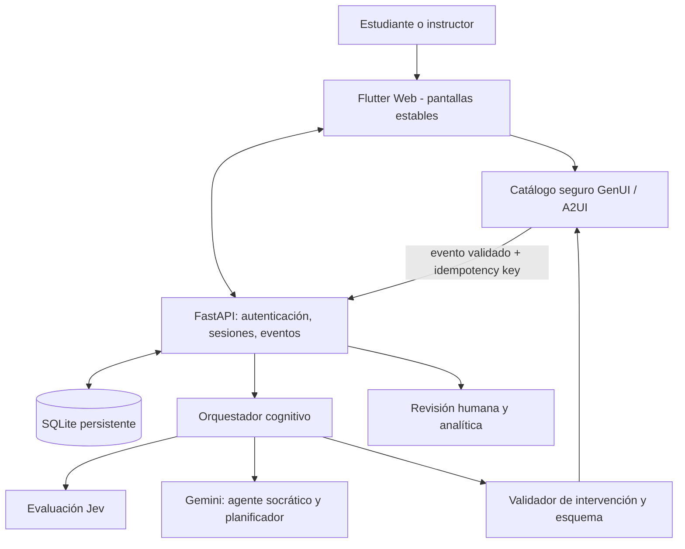

# CognitiveFlow AI — PLAN.md

> **Plan de continuación para el agente de programación (OpenCode).** Versión 2026-10-15. Este plan **no autoriza reinicializar el repositorio**. Mantener y ampliar el frontend existente, el backend disponible en el repositorio real y las decisiones de `DESIGN.md`. Prioridad: cerrar el ciclo pedagógico **experimentar → justificar → evaluar (Jev) → adaptar (Gemini) → nueva interacción GenUI → postest independiente**.

## 0. Antes de tocar código: auditoría obligatoria

1. Leer este documento, `DESIGN.md`, el plan previo con avances y `AGENTS.md`, si existe.
2. Inspeccionar `git status`, árbol del repositorio, `pubspec.yaml`, dependencias fijadas, rutas Flutter, backend FastAPI, migraciones, tests y variables de entorno; **no reemplazar nada existente**.
3. Ejecutar el sistema actual y registrar capturas de escritorio y móvil de Academia, ML Experiment Lab, otros laboratorios, Progreso e Instructor. No afirmar que se inspeccionó visualmente si no se pudo ejecutar.
4. Ejecutar `flutter analyze`, `flutter test`, `uv run pytest` (dentro de sus carpetas) y documentar fallos preexistentes y bloqueos. No tratar archivos ausentes en `app.rar` como prueba de que no existen en el repositorio real.
5. Comparar plan, código y backend. Marcar cada ticket como **verificado**, **parcial**, **pendiente** o **bloqueado** con ruta del archivo, test y evidencia. Conservar `[x]` del plan anterior como **avance reportado**, no como certificación de pruebas actuales.
6. Crear rama de trabajo y commits incrementales. No hacer cambios destructivos ni borrar DB, migraciones, historial, tokens, widgets o pantallas existentes.

### Evidencia de partida (NO confundir con pruebas de extremo a extremo)

- El plan aportado registra **18/40 tickets** cerrados en su backlog original y un vertical slice ML + evaluador mock, al 15/10/2026.
- En el `app.rar` revisado están `main.dart`, `genui/catalog.dart`, `genui/tutor_surface.dart`, `models/`, `state/` y `l10n/`. No están el backend, la base SQLite, `pubspec.yaml` ni el árbol completo del proyecto.
- `main.dart` contiene vistas de Academia, ML Experiment, Data Detective, Model Monitoring, Progreso, Instructor y revisión de sesiones. Esto demuestra presencia de código de frontend, no ejecución exitosa.
- `genui/catalog.dart`: varios componentes (`LearningCurveSimulator`, `SqlQueryWorkbench`, `ConceptMapBuilder`, `PipelineDAGBuilder`, etc.) pasan por `_simpleCard()`; **no equivalen a componentes interactivos completos**.
- `genui/tutor_surface.dart` traduce intervenciones backend a una superficie A2UI, pero debe verificarse el canal de eventos **widget → backend → agente** con el SDK GenUI efectivamente instalado.
- `state/app_state.dart` utiliza `SharedPreferences` y requiere una revisión de privacidad de tokens y borradores por estudiante/sesión.
- `main.dart` supera ~2500 líneas. Refactor por función, sin big-bang rewrite.
- La implementación real del backend y las integraciones Gemini/Jev **se deben verificar en el repositorio antes de afirmar que funcionan**.

## 1. Alcance y restricciones

**Usuarios:** cuatro estudiantes y un instructor. **Idioma:** español. **Tecnologías:** Flutter Web + GenUI/A2UI, FastAPI, SQLite/SQLAlchemy, API Google Gemini para tutoría y generación pedagógica, Jev para evaluación estructurada; `uv` para Python, Windows 11 y PowerShell. LangGraph es opcional; no añadirlo si la máquina de estados actual cumple requisitos.

**Servicios ya disponibles al usuario:** acceso/suscripción Jev y una API Google (verificar si es Gemini AI Studio o Vertex AI, sin exigir publicar ni pegar secretos). OpenCode Go se utiliza para **desarrollar**, no se presupone como API de producción para estudiantes.

**No hacer:** reescribir Flutter a otro framework; cambiar SQLite por PostgreSQL; ejecutar código arbitrario del alumno; mostrar un mock como Jev real; permitir que un LLM emita Dart/HTML ejecutable; alterar diseños ya aprobados sin revisión; hardcodear claves; exponer OpenCode a estudiantes; usar nano (usar vim si se necesita editor terminal).

**Paleta de `DESIGN.md`:** azul `#2457C5` (navegación y acción principal), teal `#0F766E` (laboratorio/experimento), ámbar `#A65B00` (reflexión/tutor). No confundir estos colores con estados de éxito/error. WCAG 2.2 AA, labels, teclado, temas claro/oscuro. El color no mide aprendizaje.

## 2. Arquitectura objetivo



**Reglas de arquitectura:** backend autoridad sobre identidades, sesiones y modo postest; Jev emite decisiones estructuradas, no feedback narrativo inventado; Gemini genera pregunta y especificación acotada del widget, no código ejecutable; el servidor valida tipo de widget, propiedades, eventos y límites; Flutter ejecuta la interacción con controles nativos. Fallas deben degradar a un estado claro, no simular evaluaciones reales.

## 3. Backlog priorizado — implementación de continuación

### P0 — Integridad técnica y preservación (primero)

- [x] **P0.1 Auditoría reproducible:** inventario de archivos existentes, rutas, versiones, endpoints, tests y deuda técnica; evidencia en `docs/current-state.md`. ✅ 2026-10-16, rama `pr-01-baseline-security` (`9dbb85b`).
- [x] **P0.2 Línea base:** ejecutar app y API, test y analyze; registrar resultados, sin modificar aún lógica de negocio. ✅ pytest 30 passed, analyze limpio, flutter test 20 passed.
- [x] **P0.3 Credenciales:** preparar `.env.example` y configuración tipada para Gemini y Jev, jamás keys en Flutter/commits/logs. Diferenciar proveedor Google AI Studio de Vertex AI según la credencial disponible. ✅ `GOOGLE_API_KEY` + comentarios añadidos; `.env`/`*.db` ignorados.
- [x] **P0.4 Seguridad mínima:** validar roles y ownership de sesiones y revisiones en backend; aislar borradores por `userId/sessionId/labId/phase`; revisar almacenamiento de token en web. ✅ ownership 403 + append-only verificados por tests.

**Aceptación:** login y navegación actual siguen funcionando; un alumno no puede consultar datos de otro; claves ausentes reportan configuración pendiente; todos los tests preexistentes preservados.

### P1 — GenUI realmente interactivo (PRIORIDAD PRINCIPAL)

- [x] **P1.1** Definir un contrato de `LearningActivity`/`UISpec` versionado con Pydantic y Dart, `widget_type`, props tipadas, `activity_id`, `session_id`, `phase`, `allowed_events`, `attempt_id`, `schema_version`. No presentarlo como A2UI oficial; implementar adaptador probado a la versión real de SDK. ✅ 2026-10-16 PR-02 (`517c931`): `schema_version` + `allowed_events` por widget (`ALLOWED_BY_WIDGET`), `EventIn` Pydantic, validación tipo en `interventionToComponent` con fallback. Sin `activity_id/phase` explícitos (la sesión + step los cubren; añadir si P3 lo exige).
- [x] **P1.2** Reemplazar `_simpleCard('LearningCurveSimulator', ...)` por renderizador real reutilizando la gráfica/sliders **ya existentes** en `LabDetailPage` (no duplicar lógica); incluir predicción previa, cambios de parámetros, justificación y envío. ✅ sliders + `predictionSubmitted`; la curva sigue en `LabDetailPage` (el widget GenUI no duplica fetch).
- [x] **P1.3** Implementar `EvidenceComparison` funcional: comparar curvas/evidencia, seleccionar datos relevantes, redactar argumento, emitir evento. ✅ chips train/val/both + argumento → `evidenceSelected`/`argumentSubmitted`.
- [x] **P1.4** Implementar `HypothesisEditor` funcional: hipótesis inicial, revisión y justificación del cambio; mostrar historial de versiones sin filtrar soluciones en postest. ✅ guardados numerados `revision` N; historial visible solo como contador (full historial si lo pide instructor).
- [x] **P1.5** Canal bidireccional: eventos reales `parameterChanged`, `predictionSubmitted`, `hypothesisSubmitted`, `evidenceSelected`, `argumentSubmitted`, `hintRequested`; enviar al backend autenticado, esquema validado, `client_event_id` para idempotencia y trazabilidad SQLite. No enviar eventos sensibles o puntuaciones supuestas desde UI como fuente de verdad. ✅ `POST /sessions/{id}/events` + tabla `ui_events` (PK=`client_event_id`), validación widget×evento, smoke E2E OK.
- [ ] **P1.6** Estados resilientes: loading, reconnect, widget desconocido, formato inválido, falta de conexión, reintento seguro, reanudación tras recargar. Parcial PR-02: fallback `Actividad no disponible` + `onEvent` null-safe + errores existentes en `LabSession`; falta reconnect/reanudación.
- [x] **P1.7** Tests de contrato (payload backend→A2UI→Flutter y evento Flutter→backend), tests de widget y una prueba E2E de laboratorio. ✅ 4 backend (idempotencia, 422, 403, contrato) + 4 frontend (3 emisiones + fallback); smoke E2E manual contra :8001; E2E automatizada de laboratorio pendiente.

**Aceptación obligatoria:** en una sesión real, el estudiante ajusta parámetros, genera eventos en la DB, responde; el backend devuelve `EvidenceComparison` o `HypothesisEditor`; la interacción aparece y su siguiente respuesta vuelve al backend. El catálogo conserva fallback de tarjeta accesible si falla una especificación; no confundir fallback con objetivo completo.

### P2 — Jev real + feedback que enseñe

- [x] **P2.1** Revisar documentación y credenciales del **proveedor Jev realmente contratado** (TypeSafe AI vs otro host). No asumir URL ni paquete por el nombre Jev. Preferir SDK oficial cuando corresponda y verificar sintaxis/versiones reales. ✅ 2026-10-16 PR-03 (`3d3557f`): doc oficial `jev-api.org/jev-python` (2026-10-09) verificada vía browser — `typesafe-sdk` PyPI o POST `{base}/v1/systemone`; keys `jeva_...` del dashboard (no valen TypeSafe console); errores 401/402/422/429/502. Nuestro POST ya coincidía; se añade `model` explícito. Sin SDK nuevo (httpx + reintento bastan).
- [x] **P2.2** Mantener adaptador `CognitiveEvaluator`, `MockEvaluator` y `JevEvaluator`; utilizar el mock solo para tests/demo etiquetada. Contexto: consigna + referencia/curvas + respuesta + rúbrica versionada. Adaptar preguntas a lo que Jev soporta, sin convertir confidencias en nota arbitraria. ✅ mock etiquetado intacto; Jev solo ML; env `JEV_*` con fallback `TYPESAFE_*`.
- [x] **P2.3** Criterios calibrables 0–4: exactitud conceptual, evidencia, causalidad, alternativas, revisión; anclajes concretos, decisiones de Jev y normalización auditable. Guardar provider, modelo/versión si se informa, raw response saneada, latencia, estado y rubric_version. ✅ `provider`/`model`/`latency_ms` en resultado + `mapping` documentado como heurística UI (no calibración); raw completa no se persiste (solo scores; ampliar si instructor lo exige).
- [x] **P2.4** Formato de feedback pedagógico: mostrar **fortaleza → evidencia faltante → pregunta siguiente** redactada por Gemini con base en Jev; diferenciar evidencia observada vs inferencia. Evitar pantalla de meros IDs y números como `uses_validation_curve · 3`. ✅ `ResultPanel`: etiquetas humanas + línea fortaleza/a-trabajar + pregunta socrática; composición Gemini completa queda para P3.
- [x] **P2.5** Timeout, rate limits, auth errors, errores 5xx, retry con límites: evaluación pendiente/fallida, nunca 100% por defecto. Revisión del instructor y comparación evaluador-humano conservando registros originales. ✅ 401/402/422→pending con motivo; 429/502/timeout→1 reintento sin sleep, luego pending; append-only intacto.
- [x] **P2.6** Golden set de respuestas sobre overfitting: correctas bien justificadas, correctas sin evidencia, errores comunes, ambigüedades, prompt injection y respuestas vacías; tests sin llamadas pagadas + pequeño test de integración opt-in. ✅ 4 tests mock + `test_jev_live_opt_in` (skip salvo `JEV_LIVE_TEST=1`; pendiente gasto de 1 crédito con tu key). ✅ Verificado en vivo 2026-10-16: `1 passed` contra jev-api.org con tu key (1 crédito).

**Aceptación:** una respuesta sólida y una débil producen diagnósticos distintos y no filtraciones; la UI indica qué observó el evaluador y su limitación. El instructor puede revisar discrepancias.

### P3 — Gemini como agente socrático y tutor contextual

- [x] **P3.1** Verificar modelo y cuota de la API de Google; implementar cliente asíncrono con autenticación del lado backend, timeouts, control de costo y logging sin PII. Prompts versionados. ✅ 2026-10-16 PR-04 (`e904a3e`): `_gemini_ask` async (`httpx.AsyncClient`, timeout 10s, 1 reintento en 503); prompt `socratic-v1` con guarda anti-inyección y `prompt_version` en respuesta; prompt truncado a 1500 chars (control de costo); sin logging con PII (no hay logs de contenido). Cuota no verificada sin gastar (pendiente 1 llamada real si la quieres).
- [x] **P3.2** Implementar máquina de estados: diagnóstico → predicción → exploración → justificación → evaluación → intervención → revisión (máximo N) → postest bloqueado → reflexión → cierre. Persistir transiciones; recuperable tras recarga. ✅ fase derivada de datos (`prediccion/justificacion/evaluacion/intervencion/revision/postest/cierre`) en `GET /sessions/{id}`, sin tabla nueva; postest/reflexión ya bloqueaban.
- [x] **P3.3** Tutor de pantalla dividida desktop: actividad principal izquierda, chat/pistas/contexto derecha; en móvil, panel contraíble. No reemplazar la actividad con chat. Historial por sesión. ✅ `ExpansionTile` colapsable con historial (`GET tutor-history`, preguntas persistidas en `ui_events`); layout 2 columnas desktop ya existía.
- [x] **P3.4** Motor de decisión basado en Jev: `request_evidence`, `contrast_example`, `simplify`, `explore_alternative`, `increase_difficulty`, `human_review`. Salida tipada validada; un widget principal por turno. Reglas deterministas como fallback. ✅ 6 estrategias menos `simplify` (débil→`request_evidence` ya simplifica; añadir si el piloto lo pide); `transfer` renombrado a `explore_alternative`/`increase_difficulty`; `human_review` ante eval pendiente.
- [x] **P3.5** Límites: máximo de intervenciones y tokens, detectar bloqueo, posibilidad de pedir explicación después de intentos razonables; postest niega tutor/pistas desde servidor. Protegerse contra instrucciones adversariales dentro de texto de estudiante/curso. ✅ `MAX_REVISIONS=6` → deriva a postest; postest bloquea socratic/intervención (test); guarda anti-inyección en prompt.
- [x] **P3.6** Tests: respuestas deficientes vs sólidas llevan a estrategias diferentes; no hay bucles infinitos; errores de Gemini no hacen perder intentos. ✅ 6 tests nuevos (contraste, human_review, dificultad, tope, fase+historial, guarda); socratic separado de evaluate (el intento se conserva si falla la pregunta).

**Aceptación:** Gemini usa el estado del estudiante y Jev para formular preguntas contextualizadas y cambiar la actividad permitida, no dar respuestas prefabricadas a toda consulta.

### P4 — Postest, dominio y progreso

- [x] **P4.1** Crear postest con **problema equivalente pero nuevo**, cerrado a ayudas en backend y UI. Evitar reutilizar exactamente la misma gráfica/solución. ✅ 2026-10-16 PR-05 (`bfa2adf`): variante determinista por sesión (`seed` 100-899, complejidad 6-9, ruido 15-35) fijada por el servidor; begin idempotente + submit único (403 al segundo); sliders ML bloqueados en postest; mismo flujo en los 3 labs.
- [x] **P4.2** Registrar baseline/pretest y postest, separar **progreso de actividad** de **dominio demostrado**. El tiempo, clics y porcentaje de finalización no equivalen a habilidades. ✅ `GET /me/progress` (baseline primer intento vs postest, por criterio) + auto-evaluación del postest guardada sin mostrarse; `ProgressPage` muestra Base→Postest por habilidad.
- [x] **P4.3** Panel estudiante: por habilidad, evolución de intentos, correcciones justificadas, evidencias y próximos temas. Distinguir resultados de modelo de evaluación humana. ✅ chips por criterio base→postest + `reviewed`/`pending_review` en progreso; próximos temas fuera de alcance (sin grafo curricular).
- [x] **P4.4** Panel instructor: matriz de cuatro alumnos × competencias, errores conceptuales recurrentes, revisión y corrección de evaluaciones, actividad asignada, exportación anónima; permisos de instructor verificados por API. ✅ `GET /instructor/matrix` (403 estudiante) + `_MatrixCard` por alumno con deltas y aviso de revisión pendiente; export anónimo ya existía; `GET /instructor/agreement` mide acuerdo Jev-humano por criterio.
- [x] **P4.5** Resumen de fin de sesión constructivo con pico-fin auténtico: una mejora observada + un siguiente desafío, sin felicitación automática a respuestas incorrectas. ✅ `reflection` devuelve `summary {mejora, desafio}` desde deltas reales (`mejora: null` si empeora); UI lo muestra con etiquetas humanas.
- [x] **P1.6** Estados resilientes: loading, reconnect, widget desconocido, formato inválido, falta de conexión, reintento seguro, reanudación tras recargar. ✅ PR-05b (`56c45c1`): `GET /me/sessions` + `last_eval`/`variant` en detalle → `LabSession.resume()` reanuda sin re-evaluar (cero créditos) en los 3 labs; borradores ya persistían; errores de red muestran mensaje + reintento.
- [x] **Raw Jev + audit trail**: `raw_answers` saneados en cada evaluación Jev; `intervention_log` append-only + `GET /sessions/{id}/interventions` (estrategia por intento).
- [x] **Estrategia `simplify`**: primer intento débil simplifica antes de pedir evidencia (test de dos pasos).
- [ ] **Calibración 0–4 con humanos**: instrumento listo (`/instructor/agreement`); la validación real exige datos del piloto P7.

**Aceptación:** postest no permite pista mediante llamada directa HTTP; el instructor visualiza evidencias de antes/después y puede auditar cambios.

### P5 — Completar los otros laboratorios sin sobreingeniería

- [ ] **P5.1 Data Detective:** conectar explorador de DataFrame (selección/filtrado/marcado de anomalías) con justificación, Jev y pregunta adaptativa. Datos sintéticos reproducibles.
- [ ] **P5.2 Model Monitoring:** distribuciones de referencia/actual, selección de feature/tiempo, justificación de drift, diferenciación entre data drift y degradación de performance; Jev y postest.
- [ ] **P5.3** Priorizar reutilizar `EvidenceComparison`, `HypothesisEditor`, `RubricFeedbackCard`; dejar editor SQL y DAG avanzado como futuro salvo necesidad demostrada.

**Aceptación:** tres laboratorios aparecen, al menos ML completo E2E; otros dos tienen interacción verdadera y no contienen componentes falsamente funcionales.

### P6 — Diseño profesional, Impeccable y refactor

- [ ] **P6.1** Seguir `DESIGN.md` sin cambiar la trifecta. Revisión `critique` inicial; `layout`, `typeset`, `distill`, `polish` por fases; utilizar inspección de Flutter Web, no asumir que herramientas HTML analizan Dart.
- [ ] **P6.2** Layout desktop dividido (actividad/tutor) y móvil sin overflow; modo concentración sin esconder controles esenciales; foco, teclado, lectores de pantalla, contraste WCAG AA.
- [ ] **P6.3** Refactor incremental de `main.dart` a features/widgets, preservando rutas/estado y añadiendo pruebas por extracción; no reescritura total.
- [ ] **P6.4** `ResultPanel` con etiquetas humanas, evidencia, incertidumbre y siguiente acción; mejorar placeholders y empty/error states.
- [ ] **P6.5** Completar cadenas `l10n` existentes; prueba de navegación completa + viewport móvil y desktop; si no hay herramientas de screenshot, reportarlo.

**Aceptación:** no hay regresiones de navegación, overflow o controles inaccesibles; capturas antes/después y cambios justificados.

### P7 — Seguridad, piloto y concurso

- [ ] **P7.1** Roles y acceso a API; tratamiento de tokens web (evaluar cookies HttpOnly/SameSite/CSRF según arquitectura); sanitización de respuestas; no ejecutar SQL/Python/shell sin aislamiento.
- [ ] **P7.2** DB SQLite persistente con migrations/backups; pruebas de concurrencia para cuatro estudiantes; CORS explícito, HTTPS, límites de payload y costo.
- [ ] **P7.3** Pruebas con cuatro estudiantes con consentimiento: tareas de diagnóstico, aprendizaje, postest y entrevista; resultados descriptivos, **sin afirmaciones causales generalizables**.
- [ ] **P7.4** Deploy HTTPS real, smoke tests de datos, autenticación, sesiones, Jev y Gemini, fallback si fallan APIs; no logs secretos.
- [ ] **P7.5** Entregables CHARAL: repositorio y arquitectura, URL pública, pitch deck, video 5 minutos, documento de gobernanza de 3–5 páginas, README de reproducibilidad. Revisar fecha/hora exactas oficiales.

## 4. Cronograma por resultados (fecha objetivo: 31 de octubre de 2026)

| Ventana | Objetivo verificable | Si hay bloqueo |
|---|---|---|
| 15–17 oct | Auditar repo y cerrar circuito GenUI de `LearningCurveSimulator` + eventos | Preservar ML Flutter y exponer integración mínima segura |
| 18–20 oct | Jev real, feedback humano, golden set y fallbacks | Usar mock claramente etiquetado en demo, sin simular Jev |
| 21–23 oct | Gemini tutor contextual, decisión de intervención y evento de retorno | Regla pedagógica determinista y Gemini solo en una intervención |
| 24–26 oct | Postest, progreso, instructor; simplificar Data Detective y Monitoring | Priorizar ML de extremo a extremo |
| 27–28 oct | QA, responsive, diseño, piloto exploratorio con 4 alumnos | Registrar limitaciones, no inventar métricas |
| 29–30 oct | Deploy, capturas, video, deck, gobernanza y smoke tests | Congelar features y arreglar solo P0/P1 |
| 31 oct | Revisar enlace, repo, demo y entrega en portal | Confirmar hora de corte |

**Prioridad absoluta si el tiempo es corto:** un único laboratorio ML completo con widget real, eventos, Jev, tutor Gemini, postest y revisión humana es preferible a 12 widgets simulados.

## 5. Especificaciones concretas y contratos mínimos

### Flujo backend (no inventar endpoints duplicados; mapear a los existentes)

```text
start session → present initial challenge
 → widget interaction (recorded event)
 → submit hypothesis and evidence
 → evaluate via Jev (or clearly marked mock)
 → choose intervention using Gemini + guardrails
 → validate UISpec, adapt to A2UI
 → render approved interactive widget
 → record next interaction and revised hypothesis
 → posttest new scenario (no tutor)
 → instructor review + honest summary
```

### Ejemplo de evento INTERNO (ilustrativo, no especificación oficial A2UI)

```json
{
  "schema_version": 1,
  "client_event_id": "uuid-generated-once-per-event",
  "session_id": "session-uuid",
  "activity_id": "activity-uuid",
  "widget_type": "LearningCurveSimulator",
  "event_type": "predictionSubmitted",
  "payload": {
    "complexity": 7,
    "noise_pct": 20,
    "hypothesis": "La validación empeora por sobreajuste"
  }
}
```

### Ejemplo de salida INTERNA de planificador, validada antes de convertir a A2UI

```json
{
  "strategy": "request_evidence",
  "widget_type": "EvidenceComparison",
  "widget_parameters": {"comparison_id": "learning_curves_v1"},
  "socratic_question": "¿Qué diferencia observable entre las curvas apoya tu conclusión?",
  "requires_justification": true,
  "max_hints": 1
}
```

**Seguridad del contrato:** nunca aceptar `score`, `role`, `student_id` o soluciones supuestas del cliente como verdad; derivar ownership en backend. Validar límites numéricos, listas de widgets/events y strings. Capturar UUID evento y deduplicar. En postest bloquear solicitud de pistas incluso por API.

### Casos de prueba mínimos (automatizados)

1. Estudiante A no puede consultar ni evaluar una sesión del estudiante B (403/404).
2. Un `client_event_id` repetido produce un solo registro de interacción.
3. Widget desconocido o props inválidas producen fallback accesible, sin ejecución de código.
4. `LearningCurveSimulator` muestra curvas/sliders y reporta cambios, no solo `_simpleCard`.
5. Jev timeout/401/429 no genera 100% ni evaluación real ficticia.
6. Respuesta buena/mala produce al menos dos estrategias de intervención diferenciadas.
7. Reanudar sesión conserva cambios e hipótesis sin cruzar alumnos.
8. El postest impide hints y tutor por API; nueva variante no expone solución.
9. Instructor puede revisar sin sobreescribir evidencia cruda y exportar datos anonimizados.
10. `flutter analyze`, `flutter test`, `uv run pytest` pasan o fallos se documentan con causas exactas.

## 6. Secuencia de PR/commits recomendada

1. **PR-01 Baseline & Security:** auditoría, lockfiles, inventario, env seguro, sesiones aisladas.
2. **PR-02 Interactive GenUI:** `LearningCurveSimulator`, `EvidenceComparison`, `HypothesisEditor`, eventos y tests.
3. **PR-03 Jev Evaluation:** API real, rúbricas, fallbacks y explicación legible.
4. **PR-04 Gemini Socratic Agent:** orquestación, prompt/estrategias y panel contextual.
5. **PR-05 Posttest & Instructor:** evaluación independiente, progreso y panel humano.
6. **PR-06 UX/QA:** diseño, refactor progresivo, accesibilidad y pantalla móvil.
7. **PR-07 Competition Demo:** Data Detective/Monitoring mínimamente funcional, deploy, documentación y pitch.

Después de cada PR incluir: archivos tocados, qué estaba antes, qué cambió, evidencia/test, riesgos, screenshots cuando sea posible, deuda nueva y tickets terminados. No marcar un ticket completo hasta demostrar su criterio de aceptación.

## 7. Orden inmediata para OpenCode — COPIAR Y EJECUTAR

> **Continúa el repositorio actual CognitiveFlow AI.** Antes de programar, inspecciona código, lockfiles, tests, API y BD existentes. Lee `PLAN.md` y `DESIGN.md`. Preserva módulos, laboratorios, datos y mejoras ya implementadas; no inicialices proyectos nuevos. Empieza por PR-01 y PR-02: audita `genui/catalog.dart`, `genui/tutor_surface.dart` y el `LabDetailPage`; convierte el `LearningCurveSimulator` de tarjeta estática a widget interactivo reutilizando la gráfica/sliders actuales, y crea el circuito bidireccional de eventos validado con persistencia backend. Incluye tests reales y ejecuta Flutter analyze/test y pytest. Una vez funcionando, integra Jev contratado con su SDK/API validada y Google Gemini como agente socrático. No hardcodees secretos ni presupongas que los endpoints anteriores existen; verifica. Refactoriza de forma incremental, conserva SQLite, la trifecta de `DESIGN.md` y el acceso por roles. Nunca utilices nano; si necesitas editor de terminal utiliza vim. Reporta qué has validado, qué sigue pendiente y cómo reproducir cada resultado.

## 8. Referencias en repositorio

- `DESIGN.md`: tokens, colores, UX, accesibilidad y señalización cognitiva.
- `COGNITIVEFLOW_PLAN(2).md` o plan previo con avances: currículo de 8 módulos, checklist histórico y criterios de CHARAL.
- `app.rar`: instantánea parcial del frontend (no sustituye una auditoría del repositorio real).
- Documentación oficial actual de Flutter GenUI, paquete Dart y SDK Jev correspondiente a la cuenta contratada; documentación actual de Gemini API según tipo de credencial. Fijar versiones en lockfiles.

**Definition of Done del proyecto:** un juez puede abrir una URL HTTPS, entrar como estudiante demo, predecir y manipular un experimento, justificar, recibir evaluación Jev auténtica, conversar con Gemini, completar una intervención GenUI interactiva y un postest sin ayuda; el instructor puede revisar y exportar evidencias; tests y documentación permiten reproducirlo. Si algún servicio no está disponible, la app presenta un estado explícito de fallo, no una demostración engañosa.
