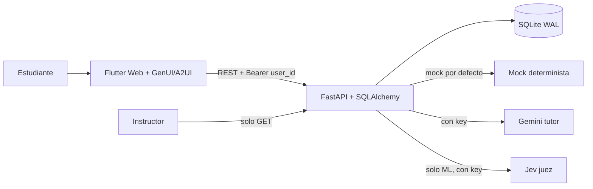

# CognitiveFlow AI — MVP

Plataforma de enseñanza activa (piloto: 4 estudiantes + 1 instructor solo lectura).
Sprints 0–4 cerrados y verificados; Sprint 5 parcial (falta deploy real, video, deck,
documento ético y piloto consentido). Detalle vivo en `docs/current-state-audit.md`.

## Correr (2 terminales PowerShell)

```powershell
# Terminal 1 — backend
cd backend
uv sync
cp .env.example .env   # y edita keys solo si usarás Gemini/Jev reales
uv run python -m app.seed
uv run uvicorn app.main:app --reload --port 8000
```

```powershell
# Terminal 2 — frontend (web-server: chrome -d falla en este equipo)
cd frontend
flutter pub get
flutter run -d web-server --web-port 8080 --dart-define=API_BASE_URL=http://localhost:8000
# abrir manual: http://localhost:8080
```

Verificar: http://localhost:8000/health, http://localhost:8000/modules

## Arquitectura



- Contratos: `backend/app/interventions.py::CATALOG` (16 widgets) ==
  `frontend/lib/genui/catalog.dart::cognitiveFlowWidgets`. `ui_spec` interna se
  traduce a A2UI en `frontend/lib/genui/tutor_surface.dart`.
- Reglas: `evaluation_results` append-only; revisión humana fuera de la UI;
  `EVALUATOR_MODE=jev|mock`, etiqueta `mock` siempre visible; sin keys en cliente.

## Tests (cero costo: mocks + SQLite memoria; CI sin red)

```powershell
cd backend; uv run pytest -q            # 74 passed, 1 skipped (live opt-in)
cd frontend; flutter analyze --no-pub   # limpio
cd frontend; flutter test               # 51 passed
```

## Backup y restore (SQLite)

- Backup: `GET /instructor/backup` con token instructor → descarga
  `cognitiveflow-backup.db` (test: solo instructor, 403 resto). Además hay copia
  local `backend/cognitiveflow.backup-*.db` (ignorada en git, nunca commitear `*.db`).
- Restore: detener API → reemplazar `cognitiveflow.db` por el respaldo →
  arrancar (`ensure_columns` + seed reponen lo que falte sin borrar datos).
- En Render: disco persistente 1 GB (`render.yaml`) + `DATABASE_URL` al disco;
  TLS lo pone la plataforma. Secrets (`GEMINI_API_KEY`, `JEV_API_KEY`) por
  entorno, jamás en repo ni en Dart.

## Simulado vs real (honesto)

| Pieza | Estado |
|---|---|
| Curvas/datasets/distribuciones | Simulación determinista etiquetada |
| Evaluador | Mock determinista; Jev real solo ML con key (`pending` si falla) |
| Tutor | Mock; Gemini real solo con key, salida validada y topada |
| Postest | Variante nueva por sesión, tutor bloqueado (403) |
| Docker D01/D02/D04/D07 | Widgets MVP + blueprints; labs Docker completos pendientes |
| Postest Monitoring | Deriva siempre en `temp` (nueva feature pendiente) |

## Pendiente humano

Deploy real + verificar HTTPS, video 5 min, deck, documento ético 3–5 páginas,
piloto consentido con 4 estudiantes, critique visual Impeccable sobre el build.

